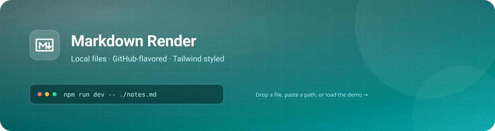

# Markdown Render



A small, local-first viewer for Markdown files. Drop a file, open one by path, and read it in a
clean Tailwind-styled page — no uploads, no accounts, no network requests once the page is loaded.

> **Everything stays on your machine.** The bundled server binds to `127.0.0.1` and only reads the
> files you explicitly ask it to open.

> **Viewing this on the public demo?** That build is hosted on GitHub Pages, so path loading and
> live reload are unavailable there. Use *Open file*, drag &amp; drop, or load a raw Markdown URL.
> Run the project locally for the full experience.

## What you get

- **GitHub-flavored Markdown** — tables, task lists, strikethrough, autolinks, and fenced code.
- **Syntax highlighting** for 190+ languages, with a copy button on every block.
- **A live outline** in the sidebar that follows your scroll position.
- **Dark mode** that respects your system preference (and remembers your choice).
- **Reading progress** at the top of the page.
- **Print / PDF export** with a dedicated print stylesheet.
- **Live reload** — edit the file in your editor and the page updates itself.

### First-run checklist

- [x] Open a file with `npm run dev -- ./samples/demo.md`
- [x] Toggle the theme with the moon/sun button
- [ ] Try dropping a `.md` file onto the window
- [ ] Open another document from the sidebar link below

## Loading files

There are four ways to get a document on screen:

1. **File picker** — click *Open file* (or press <kbd>Ctrl</kbd> + <kbd>O</kbd>). The file is read
   locally with the File API; nothing is sent anywhere.
2. **Path** — press <kbd>Ctrl</kbd> + <kbd>K</kbd> and type an absolute path, a path relative to
   the server's working directory, or a `file://` URL.
3. **URL parameter** — append `?file=/absolute/path/to/doc.md` to the app URL.
4. **Markdown URL** — paste a raw `https://` URL into the same dialog, or append
   `?url=https://raw.githubusercontent.com/user/repo/main/README.md`. This works even on a static
   host such as GitHub Pages, provided the server sends CORS headers.

```bash
# start the dev server
npm run dev

# start it and immediately load a file
npm run dev -- ../notes/architecture.md

# start it and open a browser tab
npm start

# pick another port
PORT=8080 npm run dev
```

> Relative images and links are resolved against the directory of the document, so a README with
> `` works exactly like it does on GitHub — as long as the file was opened
> **by path** through the server.

## Markdown support

### Text formatting

You can use **bold**, *italic*, ***both***, ~~strikethrough~~, `inline code`, and
[links](https://commonmark.org). Autolinks work too: https://www.markdownguide.org.

A line break at the end of a sentence like this one  
is preserved when it ends with two spaces.

### Lists

1. Ordered lists
2. Count the things
   - Nested bullets
   - With a second level
     1. And a third
3. Back to the top level

- Unordered lists
- With **formatting** inside
- And [links](#markdown-support)

### Tables

| Feature        | Shortcut                    | Notes                         |
| :------------- | :-------------------------- | :---------------------------- |
| Open a file    | <kbd>Ctrl</kbd> + <kbd>O</kbd> | Uses the File API          |
| Open by path   | <kbd>Ctrl</kbd> + <kbd>K</kbd> | Needs the dev server       |
| Toggle theme   | Moon / sun button           | Saved in `localStorage`       |
| Print          | Printer button              | Includes a print stylesheet   |

### Blockquotes

> Good documentation is a love letter to your future self.
>
> — Someone, probably

### Details and summary

<details>
<summary>Click to expand a collapsible section</summary>

Raw HTML is sanitized with DOMPurify before it is inserted into the page, so scripts and event
handlers are removed while harmless markup like this `<details>` element is kept.

</details>

## Code

Fenced blocks get a language label and a copy button. Highlighting happens locally.

```js
import { readFile } from "node:fs/promises";

const files = ["README.md", "CHANGELOG.md"];

for (const file of files) {
  const contents = await readFile(file, "utf8");
  console.log(`${file}: ${contents.split("\n").length} lines`);
}
```

```ts
type Theme = "light" | "dark" | "system";

interface Preferences {
  theme: Theme;
  autoReload: boolean;
}

export function applyTheme(theme: Theme): void {
  const dark =
    theme === "dark" ||
    (theme === "system" && matchMedia("(prefers-color-scheme: dark)").matches);

  document.documentElement.classList.toggle("dark", dark);
}
```

```css
.prose :where(code):not(pre code) {
  border-radius: 0.375rem;
  background-color: var(--color-slate-100);
  padding: 0.125rem 0.375rem;
  font-size: 0.85em;
}
```

```bash
# find every Markdown file under the current directory
find . -name '*.md' -not -path './node_modules/*' | sort

# open the newest one
npm run dev -- "$(ls -t **/*.md | head -n1)"
```

```json
{
  "name": "markdown-render",
  "private": true,
  "scripts": {
    "dev": "node server.mjs",
    "build:css": "tailwindcss -i ./src/input.css -o ./dist/styles.css --minify"
  }
}
```

An indented code block also works:

    $ echo "no fences required"
    no fences required

## How it works

The app is deliberately boring:

1. `marked` turns Markdown into HTML.
2. `DOMPurify` removes anything dangerous.
3. A few DOM passes add heading anchors, wrap tables, resolve relative links, and mount copy
   buttons.
4. `highlight.js` colors the code blocks.
5. Tailwind's typography plugin handles the prose styles, with small overrides for code, tables,
   and blockquotes.

```
markdown ──▶ marked ──▶ DOMPurify ──▶ DOM enhancements ──▶ Tailwind typography
```

### Project layout

```
MarkdownRender/
├── index.html          # the app shell
├── src/
│   ├── app.js          # rendering, TOC, theme, live reload
│   └── input.css       # Tailwind entry + component styles
├── dist/styles.css     # built CSS (committed)
├── vendor/             # marked, DOMPurify, highlight.js
├── samples/            # this file and its image
├── server.mjs          # zero-dependency dev server + path API
└── package.json
```

## Live reload

Files opened **by path** are polled every 1.5 seconds. Save in your editor and the page re-renders,
keeping your scroll position. A small green dot in the sidebar shows that watching is active.

Files opened through the picker cannot be watched — browsers do not expose a path for them.

## Keyboard shortcuts

| Keys                         | Action                    |
| :--------------------------- | :------------------------ |
| <kbd>Ctrl</kbd> + <kbd>O</kbd> | Open a file from disk   |
| <kbd>Ctrl</kbd> + <kbd>K</kbd> | Open a file by path     |
| <kbd>Esc</kbd>               | Close the outline drawer  |

## Troubleshooting

**“Could not reach the local server.”**  
The page was probably opened as a `file://` URL. Start the server with `npm run dev` and use
`http://127.0.0.1:4173`.

**An image is missing.**  
Relative images only resolve for documents opened by path. Open the file with
<kbd>Ctrl</kbd> + <kbd>K</kbd> instead of the file picker.

**The styles look unstyled.**  
Rebuild the stylesheet with `npm run build:css`. The built file lives at `dist/styles.css`.

**The port is busy.**  
Run `PORT=8080 npm run dev` and open `http://127.0.0.1:8080`.

---

That is the whole tour. Open your own notes with <kbd>Ctrl</kbd> + <kbd>K</kbd> and enjoy the
quiet.
